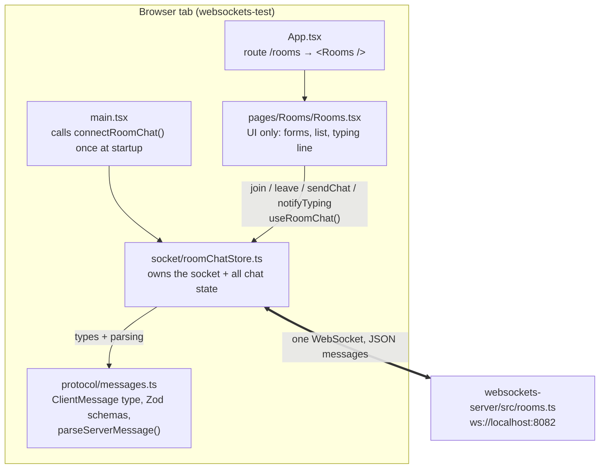
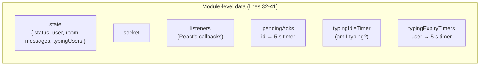
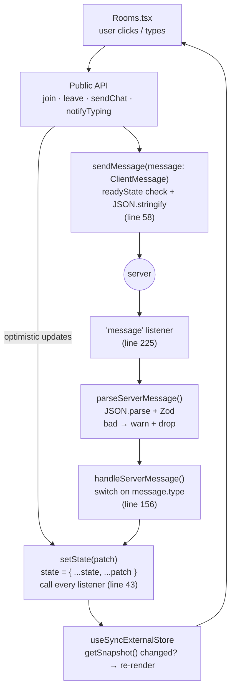
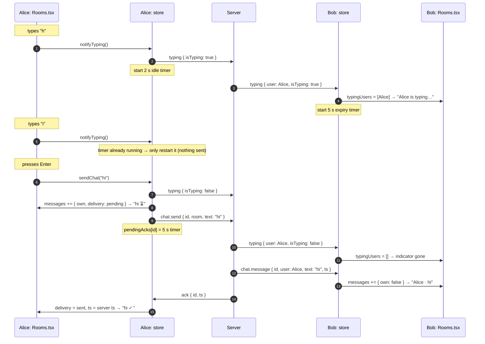

# Rooms chat: how it fits together

A map of the `/rooms` chat in three parts: what the pieces are, how the store works inside, and the full path of one message from the first keystroke to the other user's screen. Line numbers refer to the code as of this writing.

The diagrams use [Mermaid](https://mermaid.js.org). GitHub renders them, and so does WebStorm's Markdown preview (if they show as code, enable Mermaid in _Settings → Languages & Frameworks → Markdown_).

---

## Part 1. How it's built

### The pieces

Each layer has one job, and only talks to the layer next to it:

| File                             | Job                                                                                                                          | Knows about the socket? |
| -------------------------------- | ---------------------------------------------------------------------------------------------------------------------------- | ----------------------- |
| `pages/Rooms/Rooms.tsx`          | Shows the state; turns clicks and keystrokes into store calls. Keeps only form drafts in `useState`.                         | No                      |
| `socket/roomChatStore.ts`        | Owns the one socket, the chat state, and all timers. Turns UI calls into protocol messages and protocol messages into state. | Yes, the only file      |
| `protocol/messages.ts`           | Describes the wire format: what we may send (`ClientMessage`), what we accept (`serverMessageSchema`).                       | No                      |
| `websockets-server/src/rooms.ts` | Keeps room membership; forwards messages to the others in a room; acks the sender.                                           | Its own side            |

### Startup, in order

1. **`main.tsx:11`** calls `connectRoomChat('ws://localhost:8082')` before React renders anything. The socket lives at module level, so it exists once per tab, whichever page you're on.
2. **`roomChatStore.ts:217-218`** creates the `WebSocket` and sets `status: 'connecting'`.
3. React renders. When you open `/rooms`, `Rooms` calls **`useRoomChat()`** (`Rooms.tsx:49`), which subscribes to the store via `useSyncExternalStore`.
4. The handshake finishes → the `open` listener (`roomChatStore.ts:220`) sets `status: 'open'` → the badge turns green and the **Join** button enables.
5. You submit the join form → `handleJoin` (`Rooms.tsx:54`) → `join(room, user)` (`roomChatStore.ts:272`) sends `{ type: 'join' }` and sets `room` → `room !== null`, so `Rooms` swaps the join form for the chat view (`Rooms.tsx:118`).

---

## Part 2. How `roomChatStore` works

### What's inside

- **`state`** is the only thing React sees. It's one object, **replaced** (never mutated) on every change.
- **`socket`, `listeners`** and the **three timer holders** are private bookkeeping. React never reads them.

### The loop

Every change follows the same circle. There's exactly one way **out** (`sendMessage`) and one way **in** (the `message` listener), and exactly one way to change state (`setState`):

### Who changes which part of the state

| Field         | Changed by                                                                                     |
| ------------- | ---------------------------------------------------------------------------------------------- |
| `status`      | socket events: `connect` → `'connecting'`, `open` → `'open'`, `close` → `'closed'`             |
| `room`/`user` | `join` sets them; `leave` sets `room: null`                                                    |
| `messages`    | `sendChat` adds your own (⏳); `chat.message` adds others'; acks/errors/timeouts update the ⏳ |
| `typingUsers` | incoming `typing` messages, and the 5 s expiry timers                                          |

### The functions, grouped

| Group             | Functions                                                             | What they do                                                      |
| ----------------- | --------------------------------------------------------------------- | ----------------------------------------------------------------- |
| React glue        | `subscribe`, `getSnapshot`, `useRoomChat`                             | The `useSyncExternalStore` contract (Stage 2, §7).                |
| State             | `setState`, `setStatus`                                               | Replace `state`, notify listeners.                                |
| Outgoing          | `sendMessage`                                                         | The only `socket.send`. Returns `false` if the socket isn't open. |
| Incoming          | `handleServerMessage`                                                 | One `case` per server message type; ignores other rooms.          |
| Acks              | `settleAck`, `updateOwnMessage`, `failAllPending`, `clearPendingAcks` | Turn ⏳ into ✓ or ✗; ignore unknown (late) ids.                   |
| Typing (sender)   | `notifyTyping`, `stopTyping`                                          | Send `true` once, `false` after 2 s of quiet or on send.          |
| Typing (receiver) | `addTypingUser`, `removeTypingUser`, `clearTypingUsers`               | Show "X is typing…", hide on `false` or after 5 s.                |
| Public API        | `connect`, `join`, `leave`, `sendChat`, `notifyTyping`                | What the page calls.                                              |

---

## Part 3. From the first keystroke to the other screen

Alice and Bob are both in `#general`. Alice types "hi" and presses Enter.

### The same flow, step by step with code

**A. Typing starts**

1. The input's `onChange` → `handleMessageChange` (`Rooms.tsx:74`) does two things: `setMessageDraft(value)` (local React state, so the input shows the letter) and `notifyTyping()`.
2. `notifyTyping` (`roomChatStore.ts:307`): `typingIdleTimer` is `null`, so this is the first keystroke → `sendMessage({ type: 'typing', … isTyping: true })`. Then it starts the 2 s timer.
3. Server (`rooms.ts`, `case 'typing'`) forwards it to everyone else in `#general`.
4. Bob's `message` listener → `parseServerMessage` → `handleServerMessage`, `case 'typing'` (`roomChatStore.ts:175`) → room matches → `addTypingUser('Alice')` → `setState({ typingUsers: ['Alice'] })` and a 5 s expiry timer.
5. Bob's `useSyncExternalStore` sees a new snapshot → `Rooms` re-renders → `formatTyping` (`Rooms.tsx:31`) shows "Alice is typing…".

**B. More typing**

6. Each later keystroke calls `notifyTyping` again. The timer exists, so it's only **restarted** (`roomChatStore.ts:315`). Nothing goes over the wire. That's why a burst of typing produces one `typing: true` frame.
7. _(If Alice stopped for 2 s instead, the timer would call `stopTyping` and send `isTyping: false`.)_

**C. Sending**

8. Enter submits the form → `handleSend` (`Rooms.tsx:64`): `preventDefault()`, trim, `sendChat('hi')`, then clear the draft.
9. `sendChat` (`roomChatStore.ts:282`):
   1. `stopTyping()` → clears the idle timer, sends `isTyping: false`.
   2. `id = crypto.randomUUID()`.
   3. **Optimistic update:** `setState` appends `{ id, text: 'hi', own: true, delivery: 'pending' }` → Alice's list re-renders, "hi ⏳" appears on the right (`renderMessage`, `Rooms.tsx:85`).
   4. `sendMessage({ type: 'chat.send', id, payload: { room, text } })`.
   5. `pendingAcks.set(id, setTimeout(…5 s…))`.

**D. The server**

10. `rooms.ts`, `case 'chat.send'`: validates with Zod, checks Alice is in `#general`, then sends `chat.message` to the **others** in the room and `ack { id }` back to Alice.

**E. Bob receives**

11. `typing: false` → `removeTypingUser('Alice')` → "Alice is typing…" disappears.
12. `chat.message` → `case 'chat.message'` (`roomChatStore.ts:158`) → room matches → `setState` appends `{ …, own: false, delivery: null }` → "Alice · hi" appears on the left.

**F. Alice gets the ack**

13. `ack` → `case 'ack'` (`roomChatStore.ts:170`) → `settleAck(id, { delivery: 'sent', ts })`:
    - finds the timer in `pendingAcks`, clears it, deletes the entry,
    - `updateOwnMessage` replaces that one message with `delivery: 'sent'` and the server's timestamp → "hi ✓".

### When it doesn't go well

All of these end in the same place, `settleAck(id, { delivery: 'failed' })` or `failAllPending()`, so the message shows ✗:

| What happened                         | Where it's caught                                              |
| ------------------------------------- | -------------------------------------------------------------- |
| No ack within 5 s (`/noack`)          | the timer from step 9.5 fires                                  |
| Server rejects it (`error` with `id`) | `case 'error'` (`roomChatStore.ts:190`)                        |
| Socket closes while waiting           | `close` listener → `failAllPending()` (`roomChatStore.ts:253`) |
| Socket wasn't open at send time       | `sendMessage` returns `false` → `updateOwnMessage` (line 295)  |
| Ack arrives after the timeout         | `settleAck` finds no timer → ignored, stays ✗                  |
